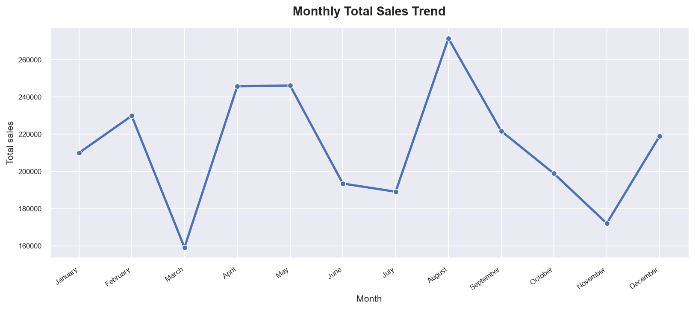
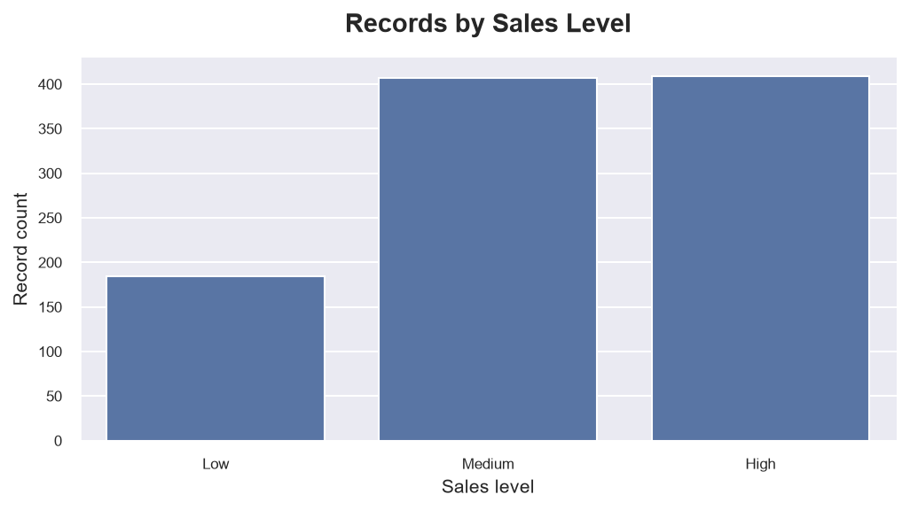
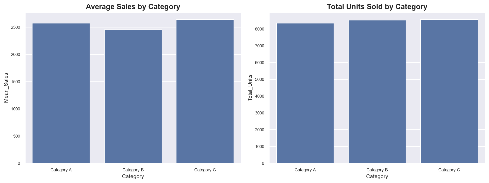
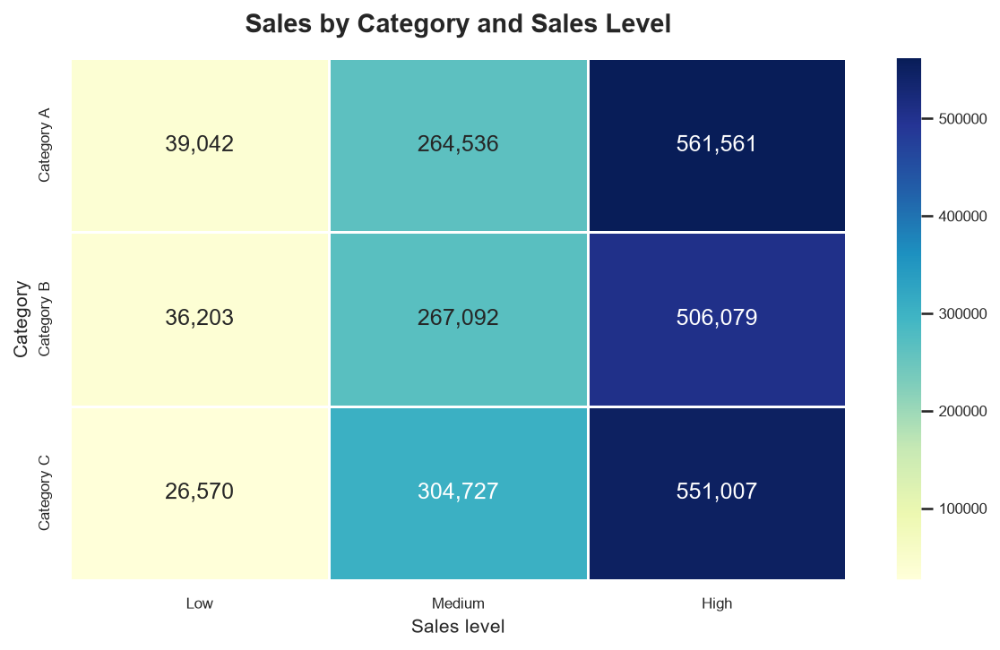

# Sales Data Analysis with Python (Pandas, Matplotlib, Seaborn)


A data analysis project that cleans and explores one year of sales data (1,000 orders, 2023) and turns the results into practical advice for growing sales.

## Table of contents
- [Business question](#business-question)
- [Dataset](#dataset)
- [What the notebook does](#what-the-notebook-does)
- [Key findings](#key-findings)
- [Visual highlights](#visual-highlights)
- [Recommendations](#recommendations)
- [Limitations](#limitations)
- [Repository structure](#repository-structure)
- [How to run](#how-to-run)
- [Tools](#tools)
- [Author](#author)

## Business question
**Where can this business grow sales?** The project looks at timing (which months sell most), order value (which orders matter most), product categories, and whether discounts actually make customers buy more.

## Dataset
File: `Thesis_Project_Dataset_1000_Rows.xlsx` (sheet `Raw_Dataset`). It holds order-level records for 1 Jan 2023 to 31 Dec 2023. Customers appear only as anonymous codes.

| Column | Description |
|---|---|
| `ID` | Order ID |
| `Date` | Order date (stored as text in the raw file) |
| `Category` | Product category (Category A, B or C) |
| `Sales` | Sales value of the order (currency is not stated) |
| `Quantity` | Units in the order (1 to 49) |
| `Discount` | Discount rate: 0%, 5%, 10% or 15% |
| `Customer_Code` | Customer code (has extra spaces in the raw file) |

**Raw data problems found:** 1,004 rows (4 duplicates), 75 missing cells (Sales 30, Discount 25, Category 20), padded customer codes, and dates stored as text.

## What the notebook does
`Matplotlib_Pandas_1000Row.ipynb` follows a full cleaning and analysis workflow:

1. **Inspect** the data: structure, distributions, missing-value pattern.
2. **Handle missing values:** Sales filled with the median (2,610.92), Discount with 0, Category with the neighbouring record's category.
3. **Remove duplicates:** 4 repeated orders removed (1,004 rows to 1,000).
4. **Standardise:** trim customer codes, convert dates, rename columns (`Total_Sales`, `Units_Sold`).
5. **Create features:** `Year`, `Month`, `DayOfWeek` and `Sales_Level` (Low: up to 1,000; Medium: 1,000 to 3,000; High: above 3,000).
6. **Analyse:** monthly trend, sales levels, categories, category managers, top and bottom orders, correlations, outliers (IQR test).
7. **Check quality:** final dataset has 1,000 unique records, 11 columns, 0 duplicates and 0 missing cells.

The notebook produces 20 charts.

## Key findings
| Area | Finding |
|---|---|
| Overview | About 2.56 million total sales from 1,000 orders; average order 2,557; median 2,611; 25,449 units |
| Timing | August is the best month (272K, 104 orders) and March the weakest (159K, 60 orders), a 71% gap. Average order size is steady (2.3K to 2.7K), so order volume drives the swings |
| Order value | High orders (above 3,000) are 41% of orders but bring 63% of sales. Low orders (under 1,000) are 18% of orders but only 4% of sales |
| Categories | Units are almost equal. Average order: C 2,642, A 2,575, B 2,453. Differences are small and not statistically significant (p about 0.21) |
| Discounts | 61% of orders carry a discount, yet units per order stay near 25 at every level (25.8, 25.7, 25.0, 25.3 for 0%, 5%, 10%, 15%). Correlations with sales and units are close to zero |
| Outliers | The IQR test found 0 outliers: all orders are between 108 and 4,997, inside the fences (-2,164 to 7,236) |

## Visual highlights
| | |
|---|---|
|  |  |
|  |  |
|  |  |
|  | |

All 20 charts are shown inside the notebook.

## Recommendations
1. **Time the calendar:** run promotions in March, July and November; plan stock and staff for April, May and August.
2. **Upsell small orders:** use bundles and add-ons for orders under 1,000.
3. **Make discounts earn their place:** tie discounts to a minimum order value, because they do not lift units per order.
4. **Lift Category B:** review its pricing and bundles against Category C.

A 14-slide presentation of the project is in [`presentation/`](presentation/Sales_Analysis_Presentation.pptx).

## Limitations
- **Filled values:** median-filling 30 Sales values adds about 78K (3%) of sales and a small spike near 2,611. Ranking of months and categories stays the same if those rows are excluded instead. Filling Discount with 0 and Category from the previous record are assumptions.
- **One year only (2023):** the monthly pattern is a planning signal, not proof (monthly order counts differ at a borderline level, p about 0.05).
- **No cost or profit data:** the effect of discounts on margin cannot be measured.
- **No repeat customers:** every customer code appears once, so loyalty and repeat buying cannot be analysed.
- **Currency is not stated** in the data.

## Repository structure
```
.
├── Matplotlib_Pandas_1000Row.ipynb      # cleaning + analysis notebook (20 charts)
├── Thesis_Project_Dataset_1000_Rows.xlsx # raw dataset
├── presentation/
│   └── Sales_Analysis_Presentation.pptx  # 14-slide project presentation
├── images/                               # chart previews used in this README
├── requirements.txt
├── .gitignore
├── LICENSE
└── README.md
```

## How to run
```bash
# 1. Clone the repository
git clone https://github.com/<your-username>/sales-data-analysis-pandas.git
cd sales-data-analysis-pandas

# 2. (Optional) create a virtual environment
python -m venv .venv
source .venv/bin/activate        # Windows: .venv\Scripts\activate

# 3. Install the libraries
pip install -r requirements.txt

# 4. Open the notebook and choose Run All
jupyter notebook Matplotlib_Pandas_1000Row.ipynb
```
Keep the notebook and the Excel file in the same folder: the notebook loads `Thesis_Project_Dataset_1000_Rows.xlsx` from its own directory. The notebook was run start to finish without errors with pandas 3.0, matplotlib 3.11, seaborn 0.13 and openpyxl 3.1.

## Tools
Python · pandas · NumPy · Matplotlib · Seaborn · Jupyter Notebook · openpyxl

## Author
**[Your Name]**
- GitHub: [@MIDMahin](https://github.com/MIDMahin)
- LinkedIn:[@MIDMahin](https://www.linkedin.com/in/midmahin)


