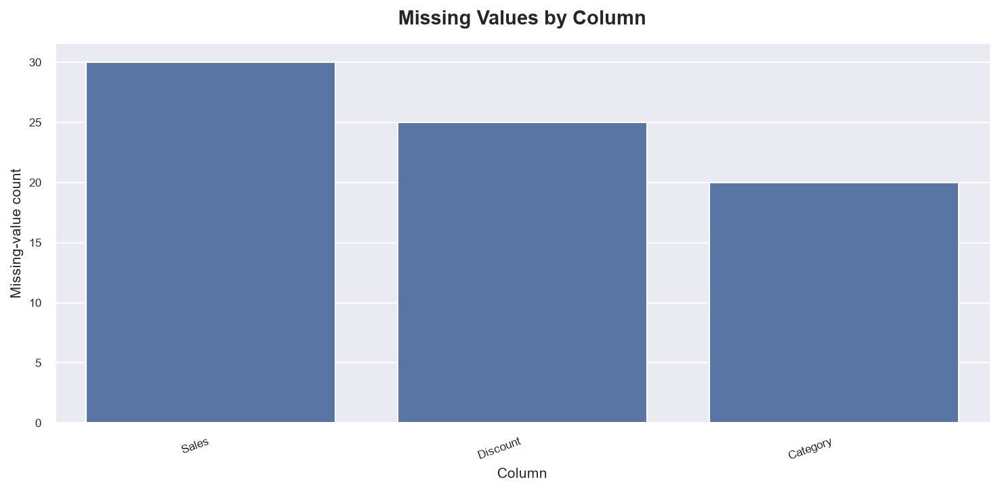
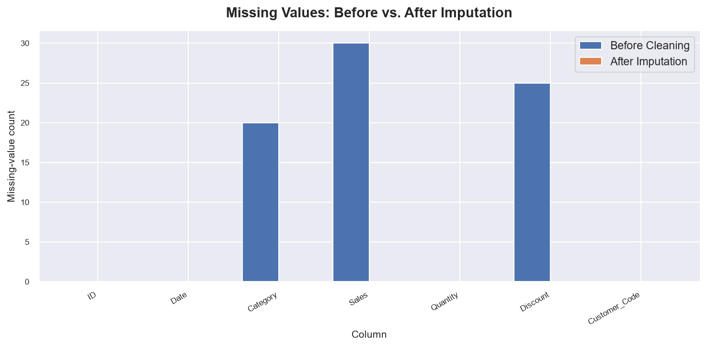
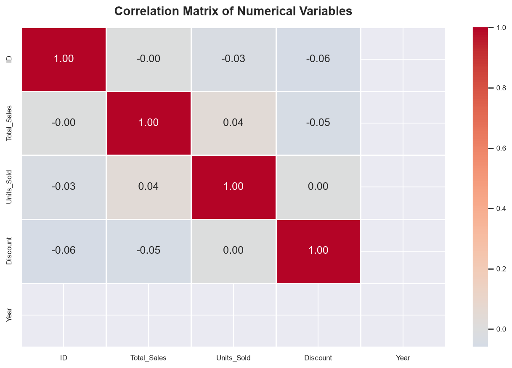

# Sales Data Analysis (Python)


An end-to-end exploratory data analysis of 2023 sales records using Python, pandas, Matplotlib, and Seaborn. The project cleans and validates 1,004 raw rows, exports a 1,000-record cleaned dataset, visualizes sales patterns, and summarizes practical business insights.

## Table of Contents

- [Project Overview](#project-overview)
- [Key Findings](#key-findings)
- [Analysis Workflow](#analysis-workflow)
- [Visualizations](#visualizations)
- [Dataset](#dataset)
- [Repository Structure](#repository-structure)
- [Getting Started](#getting-started)
- [Tools and Libraries](#tools-and-libraries)
- [Presentation](#presentation)
- [Limitations](#limitations)
- [Author](#author)

## Project Overview

The analysis answers a practical business question:

**Where did sales perform strongest and which factors are associated with order performance?**

The notebook examines:

- Monthly and category-level sales
- Order value and sales-level segments
- Sales, quantity, discount, date, and category relationships
- Top and bottom-performing orders
- Missing values, duplicate records, outliers, and final data quality

## Key Findings

The results below are based on the cleaned 1,000-record dataset.

| Measure | Result |
|---|---:|
| Total sales | 2,556,579.33 |
| Total orders | 1,000 |
| Total units sold | 25,449 |
| Average order value | 2,556.58 |
| Median order value | 2,603.03 |

- **August led monthly sales** at 271,493.93 with 104 orders.
- **March was the weakest month** at 159,135.89 with 60 orders.
- **Category C** had the highest average order value at 2,640.35.
- **Category B** had the lowest average order value at 2,441.07.
- Discounts ranged from 0% to 15%. Average units per order remained close to 25 across every discount level.
- The IQR outlier check for sales found no statistical outliers.

> Findings describe associations in a single-year dataset; they do not establish causation.

## Analysis Workflow

The notebook [`Matplotlib_Pandas_1000Row.ipynb`](Matplotlib_Pandas_1000Row.ipynb) follows this workflow:

1. Load the Excel workbook and inspect its structure.
2. Identify missing values and duplicate rows.
3. Remove 4 duplicate records.
4. Fill missing values:
   - Sales: median sales
   - Discount: 0
   - Category: nearest available record
5. Standardize customer codes and convert dates to datetime format.
6. Rename sales and quantity fields for clarity.
7. Create new features:
   - Year
   - Month
   - Day of week
   - Sales level
8. Analyze monthly trends, categories, order performance, correlations, and outliers.
9. Export the cleaned data to [`Cleaned_Sales_Data_Set_of_2023.xlsx`](Cleaned_Sales_Data_Set_of_2023.xlsx).

## Visualizations

| Missing data | Missing data comparison |
|---|---|
|  |  |

| Monthly trend | Sales-level distribution |
|---|---|
|  |  |

| Category performance | Category and sales-level heatmap |
|---|---|
|  |  |

| Correlation matrix |
|---|
|  |

The notebook contains additional charts and tables covering distributions, filtering, top and bottom records, merged category-manager data, outliers, and final data quality.

## Dataset

**Source file:** [`Sales Data Set of 2023.xlsx`](Sales%20Data%20Set%20of%202023.xlsx)  
**Sheet:** `Raw_Dataset`  
**Cleaned output:** [`Cleaned_Sales_Data_Set_of_2023.xlsx`](Cleaned_Sales_Data_Set_of_2023.xlsx)

| Column | Description |
|---|---|
| `ID` | Order identifier |
| `Date` | Order date stored as text in the raw file |
| `Category` | Product category |
| `Sales` | Order sales value |
| `Quantity` | Number of units sold |
| `Discount` | Discount rate |
| `Customer_Code` | Customer identifier |

The raw dataset contains 1,004 rows and 7 columns. Initial quality checks found:

- 4 duplicate records
- 30 missing sales values
- 25 missing discount values
- 20 missing category values
- Customer codes containing extra spaces
- Dates stored as text

## Repository Structure

```text
.
|-- Matplotlib_Pandas_1000Row.ipynb
|-- Sales Data Set of 2023.xlsx
|-- Cleaned_Sales_Data_Set_of_2023.xlsx
|-- presentation/
|   `-- SM_Mahin_Sales_Analysis.pptx
|-- images/
|-- README.md
```

## Getting Started

### Prerequisites

- Python 3.9 or later
- Jupyter Notebook or JupyterLab

### Installation

```bash
# From the project directory
python -m venv .venv

# Windows
.venv\Scripts\activate

# macOS/Linux
source .venv/bin/activate

python -m pip install --upgrade pip
python -m pip install jupyter pandas numpy matplotlib seaborn openpyxl
```

### Run the notebook

```bash
jupyter notebook Matplotlib_Pandas_1000Row.ipynb
```

Run the notebook from the project directory so it can locate `Sales Data Set of 2023.xlsx`.

## Tools and Libraries

- Python
- pandas
- NumPy
- Matplotlib
- Seaborn
- Jupyter Notebook

## Presentation

A concise slide presentation is available at [`presentation/SM_Mahin_Sales_Analysis.pptx`](presentation/SM_Mahin_Sales_Analysis.pptx).

## Limitations

- The analysis covers only one year, so seasonal findings may not repeat in every period.
- Customer codes do not provide a reliable repeat-purchase history.
- The data does not include cost or profit values, so discount impact on margin cannot be calculated.
- The missing Sales values are median-imputed, and missing Discount and Category values use assumptions that may affect record-level analysis.
- The sales currency and geographic context are not specified.

## Author

**SM Mahin**

- GitHub: [@MIDMahin](https://github.com/MIDMahin)
- LinkedIn: [@SMMahin](https://www.linkedin.com/in/midmahin)
